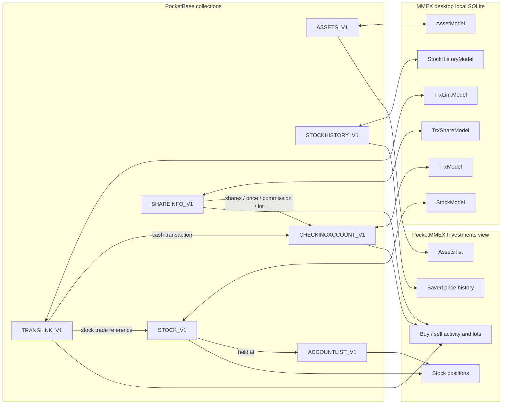

# PocketMMEX Investments

PocketMMEX groups assets and securities under one Investments view. The stored
MMEX records remain separate: an asset has its own valuation settings; a stock
position carries market data and is linked to trades; and the related cash
movement remains a normal account transaction.

## Sync order

The desktop **Sync investments** action synchronizes the prerequisites
(currencies, accounts, categories, and payees), assets, stock positions, price
history, investment-linked transactions, transaction links, and share details
in dependency order. It downloads missing rows and uploads local-only rows;
rows that differ on both sides are reported as conflicts and left untouched.
The separate **Sync transactions** action continues to sync regular
withdrawals, deposits, and transfers without investment links.

Stock history, transaction links, and share details use their MMEX row IDs.
Assets, stocks, and transactions use their MMEX business IDs. The sync compares
the serialized business fields and does not overwrite edits made on either
side. Linked transactions are only imported when their referenced asset or
stock exists; stock trades also need a share detail record.

The WebApp currently displays assets and stock records as read-only data. It
loads stock price history when the Investments view opens. It does not retrieve
live prices or combine valuations across account currencies.
