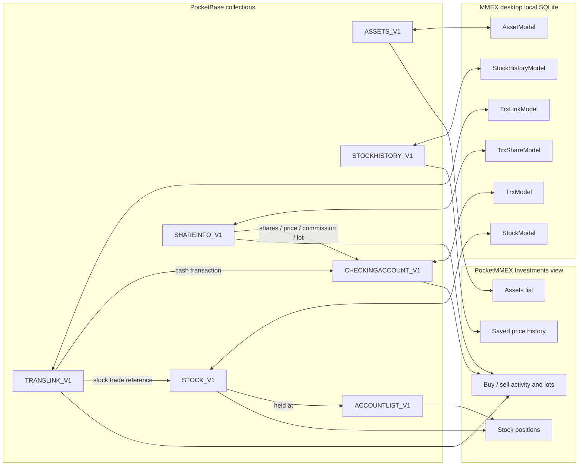

# PocketMMEX Investments

PocketMMEX groups assets and securities under one Investments view. The stored
MMEX records remain separate: an asset has its own valuation settings; a stock
position carries market data and is linked to trades; and the related cash
movement remains a normal account transaction.

## Sync order

The desktop **Sync investments** action must preserve dependencies when it
imports records: accounts and investment records first, then linked
transactions, then transaction links and share details. Upload follows the
same order so a linked record never points to a missing local business key.
Stock history is keyed by symbol and date; the other records use their MMEX
business IDs. Sync compares rows by those keys and leaves conflicting rows for
the user to resolve.

The WebApp currently displays assets and stock records as read-only data. It
loads stock price history when the Investments view opens. It does not retrieve
live prices or combine valuations across account currencies.
